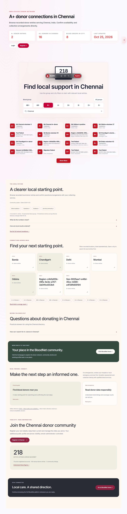

# BloodNet

**Local donor discovery today. A patient-records-first foundation for tomorrow.**

BloodNet helps people discover blood donors and voluntary organ pledges by location, while bringing personal reports and prescriptions into a dated medical history. It combines a public directory, regional landing pages, private account features, and tools for the people maintaining the service.

[Visit BloodNet](https://bloodnet.live) · [Source code](https://github.com/Shur0v/blood) · [Roadmap](ROADMAP.md) · [Contribute](CONTRIBUTING.md) · [Security](SECURITY.md)

## Contents

- [Capabilities and status](#capabilities-and-status)
- [Regional editions](#regional-editions)
- [Medical profiles](#medical-profiles)
- [Architecture](#architecture)
- [Local development](#local-development)
- [Verification](#verification)
- [Production operations](#production-operations)
- [Reach and evidence](#reach-and-evidence)
- [Contributing and licensing](#contributing-and-licensing)

## Capabilities and status

This overview describes implementation in this repository as reviewed on **30 October 2026**. The public website is available separately; source availability does not establish that every migration, setting, worker, or integration is enabled in production. Older verification reports describe their own test environments and dates.

| Area | Implemented capability | Important boundary |
| --- | --- | --- |
| Blood donor discovery | Blood-group and location filters, service cities, donor cards, pagination and coverage pages | Listings do not establish current availability or clinical eligibility |
| Organ donation | Voluntary pledges, organ categories, discovery and moderated requests | A pledge is not a transplant arrangement or medical approval |
| Public donor profiles | Publication consent, separate phone-visibility consent and administrator approval | Public profiles are separate from private medical records |
| Local guidance | Guides, published articles, FAQs and location-aware directory explanations | Hospitals assess suitability |
| Medical profiles | Patient identifiers, report uploads, prescription history and private file access | Server-side authorization and staff audit access apply |
| Administration | Donor/content management, regional design settings, homepage drafts/publication and notifications | Permissions vary by role and operation |
| Operations | Deployment checks, backups, prescription email worker and supervised recovery tooling | Recovery requires configuration and isolated rehearsal |

BloodNet is a coordination and document-management platform. It does not provide treatment, diagnose conditions, supply blood units, or determine donation compatibility. Work with your hospital, collecting service, or authorized transplant centre.

## Regional editions

The shared regional system includes country-specific palettes for [Bangladesh](https://bloodnet.live/bangladesh), [India](https://bloodnet.live/india), [Pakistan](https://bloodnet.live/pakistan), and [Nepal](https://bloodnet.live/nepal), plus an international fallback. These are representative public destinations, not a claim that every country has an independently designed experience or active coverage everywhere.

Administrators can configure country defaults and city overrides: headings, introductory text, FAQs, images with captions/credits, colors, layout, spacing, and supported section visibility. Drafts stay private until published. A published city entry replaces the country entry for that city; it is not a field-by-field merge. Removing that publication restores the country/default edition. Bounded text and design controls preserve donor-search behavior and readable contrast.

The Nepal-specific city presentation preserves the original introduction, filters and donor cards, then adds regional coverage, guidance, FAQs and registration sections. Its optional request-preparation section defaults to hidden. The main homepage has a separate draft/publication editor.

<details>
<summary>Regional design preview — synthetic local fixture</summary>



This existing October 2026 test screenshot illustrates regional customization. Names, locations and counts include synthetic fixtures; it is not evidence of production donors or outcomes. See the [regional editor verification notes](docs/regional-dashboard-editor-20261025.md).

</details>

See [regional editing](docs/regional-dashboard-editor-20261025.md), [Nepal presentation](docs/nepal-regional-edition-20261025.md), and [homepage publication](docs/homepage-editor-20261026.md).

## Medical profiles

Patients can maintain a four-character profile identifier, upload reports and prescriptions, attach supported images/PDFs, and browse a dated history with category, date and text filters. Patient-uploaded prescriptions remain distinct from prescriptions delivered by an integrated provider. Upload processing includes file validation, image optimization and retry/idempotency support.

Medical metadata, attachments and delivered prescriptions use **AES-256-GCM encryption at rest**, with a server-held key and record-specific authenticated context. Patient routes enforce ownership. Separate read-only audit endpoints allow authorized **ADMIN/MANAGER** sessions to review a selected patient's records. This is **not end-to-end encryption** or a promise that only the patient can ever read a record. Protect the original encryption key alongside backups: losing or replacing it can make records unreadable.

The server-side prescription endpoint accepts authenticated submissions from a configured provider backend and queues email delivery. That backend is responsible for clinician verification and patient consent; the endpoint does not independently verify medical licenses. Prescription email contains clinical content and is a separate delivery channel. The separate doctor portal is **future work**, not an included application. Current storage is a document archive, not diagnostic imaging or automated interpretation.

See [medical interfaces, privacy boundaries and integration details](MEDICAL_PROFILE_INTEGRATION.md). The [roadmap](ROADMAP.md) prioritizes patient records, access transparency and controlled sharing before a clinician portal.

## Architecture

| Layer | Implementation |
| --- | --- |
| Web interface | Next.js App Router, React, TypeScript and Tailwind CSS |
| Application/API | Next.js route handlers with backend services, repositories and session/role checks |
| Database | PostgreSQL with Prisma schema and versioned migrations |
| Documents/media | Encrypted medical bytes in PostgreSQL; public media uses configured R2 storage or local fallback |
| Email | SMTP for account flows and a supervised prescription-delivery worker |
| Deployment | Linux VPS tooling, Nginx, PM2, database backups and health checks |

Code is organized under `src/app` (routes), `src/components` (interface), `src/backend` (services and operations), and `src/lib` (shared behavior). Database definitions live under `prisma`; verification lives under `tests`. See [backend architecture notes](backend_architecture.md) for additional historical context; executable code remains the source of truth.

## Local development

### Prerequisites

Use **Node.js 22.12+ in the 22.x line or Node.js 24+**, npm, and a fresh local PostgreSQL database owned by a development role. You need SMTP settings for OTP/account flows and a Geoapify key for location features. Use synthetic accounts and a development mail service; never copy production medical data into a contributor environment.

### Install and configure

```sh
git clone https://github.com/Shur0v/blood.git
cd blood
npm ci
```

Copy `.env.example` to `.env` using your file manager, PowerShell `Copy-Item .env.example .env`, or shell `cp .env.example .env`. Fill the values before starting the app. Environment files are ignored by Git.

| Setting | Purpose |
| --- | --- |
| `DATABASE_URL` | Local PostgreSQL connection URL |
| `JWT_SECRET` | Independent random session secret, at least 32 characters |
| `NEXT_PUBLIC_BASE_URL`, `NEXT_PUBLIC_SITE_URL` | Set both to `http://localhost:3000` locally |
| `SMTP_HOST`, `SMTP_PORT`, `SMTP_USER`, `SMTP_PASS` | Development SMTP credentials; current validation expects an email-form username |
| `GEOAPIFY_API_KEY` | Location autocomplete/provider access |
| `MEDICAL_RECORDS_ENCRYPTION_KEY` | Independent 64-character hex key for medical storage |
| `DOCTOR_PRESCRIPTION_API_KEY`, `DOCTOR_PRESCRIPTION_SOURCE` | Optional provider integration secret and stable source identity |
| `R2_*`, `ENABLE_LOCAL_UPLOAD_FALLBACK` | Public media storage; local fallback is suitable for development |
| `ADMIN_ID`, `ADMIN_PASSWORD`, `ADMIN_ROLE` | Optional local administrator seed credentials |

Generate each new development secret independently:

```sh
node -e "console.log(require('crypto').randomBytes(32).toString('hex'))"
```

The example file also documents optional translation, search-verification and recovery settings. `NEXT_PUBLIC_*` variables are browser-visible: never place secrets there. Do not regenerate existing production keys as a setup step.

### Initialize a fresh local database

With `DATABASE_URL` pointing only to your development database:

```sh
npm run db:generate
npm run db:migrate:deploy
npm run dev
```

Open [localhost:3000](http://localhost:3000). For local administrator access, set the `ADMIN_*` values in `.env` and run `npm run seed:admin` separately. That command upserts the account and replaces an existing matching account's password/role; use it only for your intended development account.

For provider-prescription email delivery, run `npm run worker:prescriptions` in a separate terminal with the same environment. Without provider integration, patient-upload features can still be developed with the medical storage key configured. `npm run db:migrate:dev` is for authoring development migrations; `db:push` is deliberately disabled.

## Verification

Choose checks relevant to your change; see [contributor guidance](CONTRIBUTING.md).

| Command | Coverage / requirements |
| --- | --- |
| `npm run test:env` | Environment validation |
| `npm run test:security` | Session, request-origin, sanitization and input checks |
| `npm run test:discovery` | Donor discovery and ordering |
| `npm run test:regional` | Regional content/design behavior |
| `npm run test:medical` | Medical unit checks; integration cases need the isolated database below |
| `npm run test:deployment` | Database preservation/migration integration checks with the isolated database |
| `npm run test:operations` | Operational checks; recovery integration cases require additional isolated infrastructure |
| `npm run guide:check` | Checks generated platform-guide consistency without updating it |
| `npm run build` | Guide check, Prisma generation and production build; configured build environment required |

Medical/deployment integration tests require `TEST_DATABASE_URL` pointing to a **fresh, empty, loopback PostgreSQL database named `bloodnet_medical_test_<digits>`**. They create fixtures and apply migrations; never use production or a database you want to preserve. Cases skip when the variable is absent, so a passing run with skips is not full database verification. Recovery rehearsals additionally use `TEST_RECOVERY_CONTROL_URL`, an isolated PostgreSQL server on port `55444`, disposable roles/databases and compatible PostgreSQL utilities; inspect the test-specific guards before running them. Browser workflows have their own fixture/server prerequisites and are not implied by the unit commands.

## Production operations

Fresh local setup is not a production upgrade procedure. Existing deployments use the [VPS checklist](deploy/PRODUCTION_CHECKLIST.md), [database deployment audit](DATABASE_DEPLOYMENT_AUDIT.md), and [supervised recovery guide](docs/admin-operations-recovery.md).

The established VPS entry point is `bash ./deploy-prod.sh`. Review the runbook before invoking it: it updates the checkout, manages services, backs up data, builds and applies migrations. Preserve the database, encryption key, JWT secret and required private files. Supervise the prescription worker alongside the web application. Rehearse restoration on isolated infrastructure before enabling recovery operations. Historical successful test reports do not replace current deployment and restore verification.

## Reach and evidence

Maintainer-provided analytics screenshots recorded **173 visitors and 288 pageviews during 15–30 October 2026**. The selected twelve-month Search Console window showed **206 clicks and approximately 1,860 impressions**. These are early reach indicators; they do not establish completed donations or lives saved.

Read the [dated impact report](docs/impact/2026-10-30.md) for sources, limitations and counting definitions. The [network page](https://bloodnet.live/network) and [public statistics endpoint](https://bloodnet.live/api/public/platform-stats) expose current coverage; `data.publicNetwork` contains defined source-record counts. Community listings are not individual headcounts, and adding city totals can double-count people serving multiple cities.

For maintaining evidence, use the [monthly report](docs/impact/templates/monthly-report.md), [partnership record](docs/impact/templates/partnership-record.md), and [outcome collection template](docs/impact/templates/outcome-record.md). The [Codex support request](docs/CODEX_SUPPORT_REQUEST.md) connects these early indicators to concrete maintenance work.

## Contributing and licensing

Maintained by [Shur0v](https://github.com/Shur0v). Read [CONTRIBUTING.md](CONTRIBUTING.md) before opening a pull request and [SECURITY.md](SECURITY.md) before reporting vulnerabilities. Use synthetic examples and keep patient information, credentials and private production artifacts out of issues, commits and automated review tools.

Original BloodNet code that its contributors are authorized to license is offered under **AGPL-3.0-only**; see [LICENSE](LICENSE) and [licensing boundaries](LICENSING.md). Third-party dependencies, images, user content, medical records and data retain their own rights. No clinical-data access or BloodNet trademark rights are granted by the software license.
